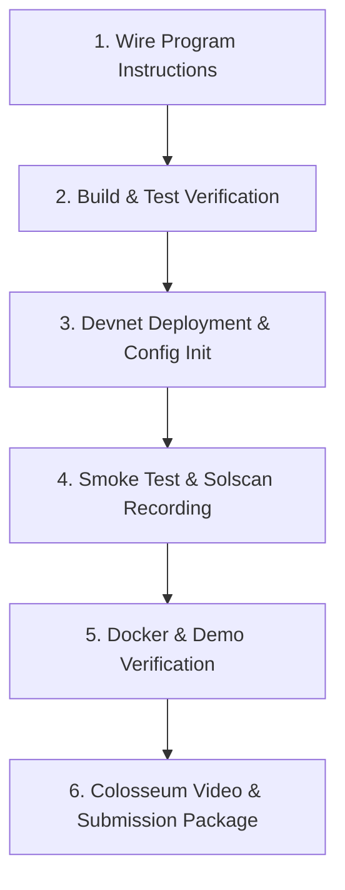

# Bestcrow — Master Development Plan & Protocol Specification

> **Canonical Master Document:** This file consolidates and supersedes `IMPLEMENTATION_PLAN.md`, `PROTOCOL_V2.md`, `DECISIONS.md`, `DEVNET_DEPLOYMENT.md`, and previous notes into a single source of truth for the **Colosseum Hackathon** and subsequent development.

---

## 1. Executive Summary & Colosseum Hackathon Strategy

### 1.1 Project Overview
* **Project Name:** Bestcrow
* **Tagline:** Back the next milestone. Non-custodial, milestone-escrow crowdfunding for startup prototypes on Solana.
* **Target Competition:** [Colosseum Hackathon](https://colosseum.com/hackathon) (feeding into the $250k pre-seed Colosseum Accelerator).
* **Target Track:** **DeFi & Capital Markets** (Primary) or **Consumer / Apps** (Secondary).

### 1.2 Core Thesis: "Post-Meme Capital Formation"
Solana has established unrivaled transaction speed and liquidity, but early-stage capital formation remains dominated by speculative memecoins (pump.fun) and high-risk token sales where founders take 100% of funds upfront with zero accountability. Conversely, Web2 platforms (Kickstarter, Indiegogo) charge 8% in combined fees, operate centralized payment custody, freeze accounts arbitrarily, and offer zero on-chain enforcement of delivery.

**Bestcrow introduces milestone-based crowdfunding:**
1. **Funds are locked in non-custodial Program Derived Address (PDA) vaults** on Solana.
2. An initial tranche provides working runway upon hitting the goal.
3. Subsequent tranches require **verifiable proof of work (Arweave SHA-256 hash)** and **contribution-weighted backer approval**.
4. Every failure path (missed deadline, rejected vote, project abandonment) is **permissionless and pro-rata refundable**.
5. The platform takes a fixed **1% protocol fee** only upon successful fundraising.

### 1.3 Strategic Positioning & Honest Disclosure
* **Independence, Not "Privacy":** Solana transactions, wallet addresses, and pledge amounts are completely public. Bestcrow does not claim financial privacy; it guarantees **custodial independence**—no operator or middleman can redirect funds or veto rules.
* **Pre-existing Code Disclosure:** The initial foundation was created during HackYeah 2026 under the Superteam Poland track (*"Finance Without Intermediaries"*). For the Colosseum Hackathon, the protocol was advanced to Protocol V2: migrating to `@solana/kit` (Solana Web3.js v2), isolating Devnet vs Mock environments, adding clickable Solscan/Explorer links, and establishing exact lamport accounting.

---

## 2. Complete MVP: Definition of Done

The MVP is a feature-complete prototype operating on **Solana Devnet** with a parallel **browser-isolated Mock mode**.

| Capability | Devnet Mode (Real Test SOL) | Mock Mode (Browser Demo) |
| :--- | :--- | :--- |
| **Wallet Interaction** | Signs real transactions via Phantom / Solflare | Browser-only session; zero wallet signing required |
| **SOL Movement** | Transfers actual test SOL between PDAs | Local numerical simulation; no SOL moves |
| **Data Verification** | Reads on-chain accounts; verifies SHA-256 against Arweave/IPFS | Uses local/browser storage mock templates |
| **Explorer Visibility** | Generates real links to **Solscan Devnet** and **Solana Explorer** | Displays clear "Mock Demo — No SOL moves" notice |
| **Campaign Creation** | Strictly requires publicly reachable terms manifest (`ar://` or `https://`) | Allows fast local mock manifest generation |

### 2.1 Scope Boundaries

* **Included in MVP:**
  * Draft campaign creation and immutable schedule sealing (2–5 tranches, $\le 50\%$ each).
  * 7–183 day fundraising window with overfunding support.
  * Backer pledge cancellation during the active funding window.
  * Permissionless funding finalization (1% fee charged to treasury on success; 0% on failure).
  * 100% individual refund claims if funding goal is missed.
  * Milestone evidence submission (SHA-256 hash committed on-chain).
  * 7-day contribution-weighted milestone voting (`yes_weight * 2 > final_raised`).
  * 30-day revision window upon first vote rejection; second 7-day vote round.
  * Permissionless tranche release and split payout execution.
  * Permissionless campaign termination and pro-rata remaining pool refunds.
  * Docker Compose local setup (`web:3000`, `api:4000/api/health`).

* **Deferred to Post-Hackathon / Mainnet (P6):**
  * Mainnet deployment with real financial value SOL.
  * Fiat on-ramps and credit card processing.
  * Physical reward shipping and address collection.
  * Arbitrary non-financial community sentiment polls.
  * Automated cron keepers (all transitions in MVP are permissionlessly callable by any caller).

---

## 3. Protocol V2 Specification & Mathematical Invariants

### 3.1 Account Architecture & Seeds

All V2 accounts use dedicated `*-v2` seeds to ensure zero collision with legacy prototypes:

```text
ProtocolConfigV2:  [b"config-v2"]
CampaignV2:        [b"campaign-v2", creator_pubkey, campaign_id.to_le_bytes()]
TrancheV2:         [b"tranche-v2", campaign_pubkey, [tranche_index]]
BackerLedgerV2:    [b"backer-v2", campaign_pubkey, backer_pubkey]
ClaimV2:           [b"claim-v2", campaign_pubkey, [tranche_index]]
Vault PDA:         [b"vault-v2", campaign_pubkey]
```

### 3.2 Economic Parameters

```text
FEE_BPS            = 100        (1.00% platform take rate)
BPS_DENOMINATOR    = 10,000
MIN_FUNDING_SECS   = 604,800    (7 days)
MAX_FUNDING_SECS   = 15,811,200 (183 days)
MIN_TRANCHES       = 2
MAX_TRANCHES       = 5
MAX_TRANCHE_BPS    = 5,000      (50.00% maximum per tranche)
VOTE_WINDOW_SECS   = 604,800    (7 days)
REVISION_SECS      = 2,592,000  (30 days)
CREATOR_BOND       = 0 SOL      (No bond in MVP; anti-spam deferred)
```

### 3.3 Exact-Lamport Accounting & Invariants

To guarantee that vaults never underflow or trap rounding dust:

1. **Protocol Fee Calculation:**
   $$\text{fee} = \begin{cases} \lfloor \frac{\text{raised} \times 100}{10000} \rfloor & \text{if } \text{raised} \ge \text{goal} \\ 0 & \text{if } \text{raised} < \text{goal} \end{cases}$$
2. **Net Distributable Budget:**
   $$\text{net\_budget} = \text{raised} - \text{fee}$$
3. **Tranche Allocation & Dust Elimination:**
   For tranches $i = 0 \dots N-2$:
   $$\text{amount}[i] = \lfloor \frac{\text{net\_budget} \times \text{share\_bps}[i]}{10000} \rfloor$$
   For the final tranche ($i = N-1$):
   $$\text{amount}[N-1] = \text{net\_budget} - \sum_{j=0}^{N-2} \text{amount}[j]$$
4. **Conservation of Lamports:**
   At all times:
   $$\text{vault\_balance} \ge \text{net\_budget} - \text{released} + \text{rent\_exempt\_minimum}$$

### 3.4 Milestone Governance & Strict Majority Rule

* **Vote Weight:** Backer's final frozen contribution lamports (`BackerLedgerV2.amount`).
* **Approval Condition:**
  $$\text{yes\_weight} \times 2 > \text{final\_raised}$$
  * An approval requires **strictly greater than 50%** of all final contributions.
  * Exactly 50%, abstentions, and non-votes count as "NOT APPROVED".
* **Two-Strike Lifecycle:**
  * **Round 1:** Creator submits evidence $\rightarrow$ 7-day vote.
  * If rejected $\rightarrow$ status becomes `Revision` for 30 full days $\rightarrow$ Creator submits revised evidence $\rightarrow$ Round 2 (7-day vote).
  * If rejected again, or if evidence deadline is missed $\rightarrow$ Milestone rejected $\rightarrow$ Anyone can call `terminate` $\rightarrow$ Remaining unreleased funds move to `refund_pool`.
* **Pro-Rata Termination Refund:**
  $$\text{refund}[backer] = \lfloor \frac{\text{backer\_amount} \times \text{refund\_pool}}{\text{final\_raised}} \rfloor$$

---

## 4. Consolidated Decision Log

* **D-001 (Canonical Scope):** Project canonical scope is startup and prototype crowdfunding with milestone releases in SOL. Legacy charity and 70%-threshold programs are archived as reference.
* **D-002 (Verification Discipline):** Documentation must strictly delineate between *proposed*, *implemented*, and *verified on Devnet*.
* **D-003 (Locked Economics):** 1% fee on success to fixed treasury; 0% fee on failure. Tranche remainder goes to the last tranche. 0 SOL creator bond in MVP.
* **D-004 (Account Isolation):** Clean V2 account seeds (`*-v2`). No backward compatibility shim with legacy devnet state.
* **D-005 (Verifiable Metadata):** Canonical JSON for terms and evidence; 32-byte SHA-256 hashes committed on-chain. Off-chain storage on Arweave/IPFS.
* **D-006 (Explicit Mode Isolation):** Devnet and Mock modes must be mutually exclusive. Browser-only mock URIs (`ar://mock...`) are rejected during Devnet campaign creation.
* **D-007 (Public Solana Transparency):** Disclose that wallet transactions are public; position the platform on *custodial independence and verifiable trust*, not privacy.
* **D-008 (Colosseum Re-Targeting):** Realign architecture, pitch deck, and submission material for Colosseum judging criteria (functionality, venture scale, Solana Web3.js v2 adoption).

---

## 5. Immediate Vibecoding Action Plan (Deadline Day)



### Checklist & Action Items:

1. **Wire Bestcrow Instructions (`rust/programs/bestcrow/src/`):**
   - Export `voting.rs` and `release.rs` in `instructions/mod.rs` and register them in `#[program] pub mod bestcrow` in `lib.rs`.
   - Ensure `anchor build` produces complete IDL.
2. **Execute Full Test Suite:**
   - Frontend: `npm test` (38/38 passing).
   - Backend: `npm test` (80/80 passing).
   - Rust: `cargo test --workspace` (unit tests passing).
3. **Deploy & Initialize on Devnet:**
   - Execute `deploy-devnet.sh` with a dedicated keypair.
   - Initialize `ProtocolConfigV2` with a designated treasury address.
   - Record signatures in `docs/deployments/devnet-v2.json`.
4. **Create Verified Devnet Proof Campaign:**
   - Connect Phantom on Devnet with test SOL.
   - Create a 3-tranche startup campaign using a permanent Arweave/IPFS or public JSON manifest.
   - Pledge 0.1 SOL from a second wallet.
   - Verify transaction on Solscan (`https://solscan.io/tx/<SIG>?cluster=devnet`).
5. **Verify Docker Compose:**
   - Run `docker compose up --build`.
   - Confirm frontend at `http://localhost:3000` and API health at `http://localhost:4000/api/health`.

---

## 6. Future Ecosystem Features (Roadmap)

### Feature A: Off-Chain Digital Reward Delivery (Steam Keys / Digital Codes)
* **Problem:** Hardware and gaming startups need to offer backer rewards (e.g. Steam beta keys, early access codes) without leaking them on the public blockchain.
* **Architecture:**
  1. Creator uploads an encrypted pool of digital keys to the backend.
  2. Each key is encrypted using AES-256 with a server secret.
  3. When a backer successfully pledges $\ge \text{threshold}$, the backend indexes the `PledgeReceived` event.
  4. The backer authenticates via linked wallet signature (Ed25519 challenge).
  5. The backend assigns exactly one key atomically to that wallet address and delivers it over authenticated HTTPS.
  6. Neither the key nor delivery status is revealed on the public chain.

### Feature B: Token-2022 / Compressed NFT Backer Badges
* When a backer pledges to a campaign, the protocol mints a **cNFT or Token-2022 Backer Pass**:
  * Attributes: Campaign ID, Tier, Pledged Amount, Voting Weight.
  * Dynamic metadata: Tranche completion stamps.
  * Utility: Can be used by the startup for token-gated Discord channels, beta software builds, or future governance.

### Feature C: Adaptive Quorum & Anti-Apathy Voting
* Transition from pure absolute majority (`yes_weight > 50% of all pledges`) to a **Quorum + Supermajority** model (e.g., 25% quorum of total raised, with 66% approval of votes cast) to prevent inactive backers from deadlocking legitimate milestones.

---

## 7. Devnet Deployment Runbook

### Step 1: Environment Setup
```bash
solana config set --url https://api.devnet.solana.com
solana address
solana airdrop 2
```

### Step 2: Build & Deploy Anchor Program
```bash
cd rust
NO_DNA=1 anchor build --no-idl -- --arch v0
solana program deploy target/deploy/bestcrow.so
```

### Step 3: Initialize ProtocolConfigV2
```bash
export TREASURY="<YOUR_TREASURY_PUBKEY>"
npm run devnet:init-config -- --treasury "$TREASURY" --evidence ../docs/deployments/devnet-v2.json
```

### Step 4: Verification Links
After deploying and creating a campaign, view the transactions:
* **Solscan Devnet:** `https://solscan.io/tx/<SIGNATURE>?cluster=devnet`
* **Solana Explorer:** `https://explorer.solana.com/tx/<SIGNATURE>?cluster=devnet`
